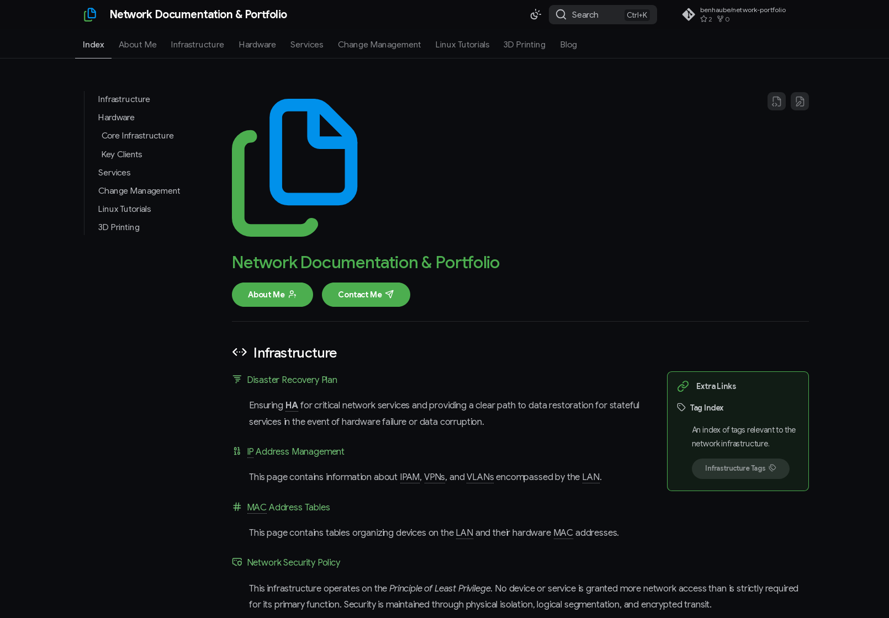
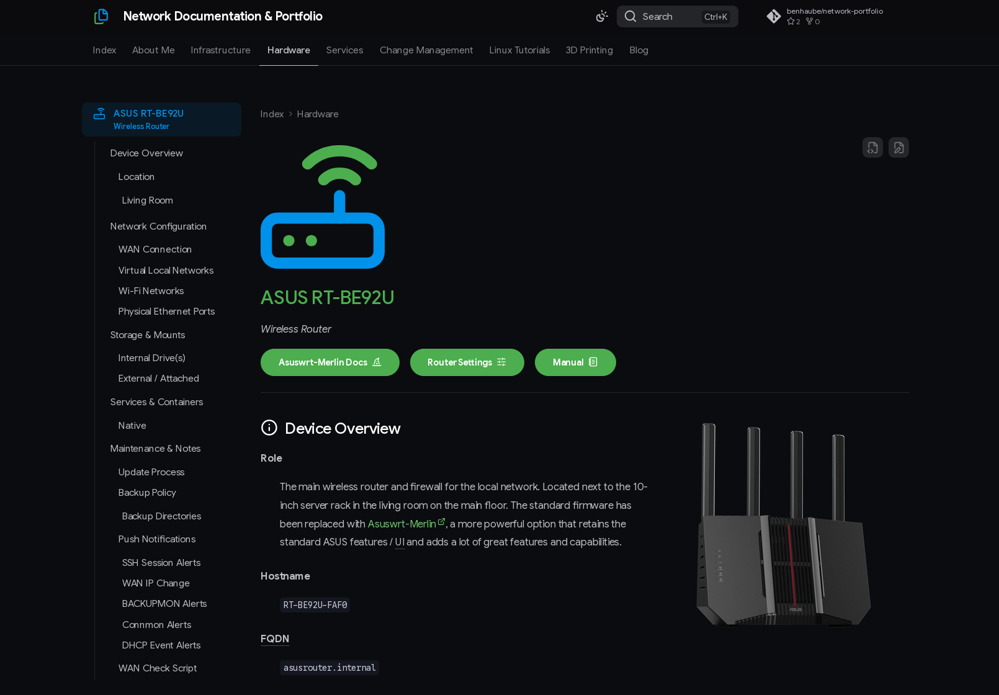

<p align="center">
    <a href="https://portfolio.rac3r4life.online">
        
    </a>
</p>

<h1 align="center" color="#4CAE4F">
  Network Documentation & Portfolio
</h1>

</p>

<p align="center">
    <a href="https://github.com/benhaube/network-portfolio/blob/main/LICENSE">
        
    </a>
    <a href="https://github.com/squidfunk/mkdocs-material">
        
    </a>
    <a href="https://github.com/lucide-icons/lucide">
        
    </a>
    <a href="https://fonts.google.com/icons">
        
    </a>
</p>

<p align="center">
  <a href="#clone-the-repo">Clone the Repository</a>
  ·
  <a href="#using-python-the-preferred-method">Build Using Python</a>
  ·
  <a href="#using-docker">Build Using Docker</a>
  ·
  <a href="#zensical-studio-for-vscode">Zensical Studio</a>
</p>

This is my personal, self-hosted professional portfolio and network documentation website built with [Zensical](https://github.com/zensical/zensical). This repository only contains the source markdown and development files. The built website in the `/site` directory is not tracked in the repo, but get's uploaded to my Nginx Web server. The website is hosted on my own server and exposed to the internet with a Cloudflare Tunnel.

You can build your own network documentation website with the configuration, directory structure, custom icon libraries, and page templates provided in this code repository. Just fork the repo and replace the `*.md` files with your own created using the templates. The provided `zensical.toml` configuration file and customized CSS can be used for any Zensical project regardless of the page content. **Note:**&ensp;You will need to change the `.nav.yml` files to reflect the names of your own markdown files.





## Clone the Repo

#### HTTPS

``` bash
git clone https://github.com/benhaube/network-portfolio.git

cd network-portfolio/
```

#### SSH

``` bash
git clone git@github.com:benhaube/network-portfolio.git

cd network-portfolio/
```

## Using Python _(The Preferred Method)_

### Setup Python Virtual Environment

``` bash
python -m venv .venv/
source .venv/bin/activate
```

### Install Zensical

``` bash
pip install zensical
```

#### Install Plugins

| Plugin                                                                               | Role                                |
| :----------------------------------------------------------------------------------- | :---------------------------------- |
| [<code>mkdocs-awesome-nav</code>](https://github.com/lukasgeiter/mkdocs-awesome-nav) | Customize the navigation structure. |
| [<code>mkdocs-glightbox</code>](https://github.com/blueswen/mkdocs-glightbox)        | Create an image gallery.            |

``` bash
pip install mkdocs-awesome-nav mkdocs-glightbox
```

### How to Upgrade

Run the following commands to upgrade Material for MkDocs and the required plugins to the latest version.

``` bash
# Material for MkDocs
pip install --upgrade --force-reinstall zensical

# MkDocs Plugins
pip install --upgrade --force-reinstall mkdocs-awesome-nav mkdocs-glightbox

# Upgrade `pip`
pip install --upgrade pip
```

#### Check Current Version

Run the following command to check the currently installed version of Material for MkDocs.

``` bash
pip show zensical
```

### Building / Serving the Site

#### Serve Site for Testing

``` bash
zensical serve
```

#### Build Site for Deployment

``` bash
zensical build
```

> [!tip]
> **Zensical** will create a new directory in the root of the repository named 'site' and build the site in that directory. Move the resulting `site/*` directory and its contents onto the Web server of your choice. Do **NOT** move any other source files or directories to the Web server.

## Using Docker

### Build the Custom Image

> [!note] 
> This project uses plugins for MkDocs that are not included with the standard Docker image. Therefore it is a requirement to pull the standard image and build a new, custom image with those plugins added. The `Dockerfile` contains the 'instructions' for **Docker / Podman** to build the custom image. The two `compose-*.yml` files already have the `localhost/zensical-custom` image defined.

#### Pull Zensical Image

``` bash
docker pull zensical/zensical:latest
```

#### Build Image w/ Extra Plugins

``` bash
docker build -t zensical-custom .
```

### Building / Serving the Site

> [!note]
> There are two compose files included in the repo. The `compose-serve.yml` file will spin up the `zensical-custom` container and serve the site to `http://localhost:8000`. It is not recommended to serve the production site in this way. It is for testing only. When you are ready to publish your changes you build the site and host it on a separate Web server. I recommend using [Nginx](https://github.com/nginx/nginx).

#### Serve Site for Testing

``` bash
docker compose -f compose-serve.yml up -d  # You can optionally remove the detach flag `-d` if you want to see the log output for debugging. 
```

#### Build Site for Deployment

``` bash
docker compose -f compose-build.yml up -d
```

> [!tip]
> **Material for MkDocs** will create a new directory in the root of the repository named 'site' and build the site in that directory. Move the resulting `site/*` directory and its contents onto the Web server of your choice. Do **NOT** move any other source files or directories to the Web server.

#### Alternative `docker run` Commands _(Not Recommended)_

Podman / Docker compose is the preferred method for starting and stopping the MkDocs container, but you can also use the following `docker run` commands.

``` bash
docker run --rm -it -p 8000:8000 -v ${PWD}:/docs:Z zensical-custom serve
```

``` bash
docker run --rm -it -v ${PWD}:/docs:Z zensical-custom build
```

> [!note]
> The `:Z` or `:z` in the volume definition _(also in the compose.yml files)_ is critical for **Fedora / Podman** based workstations that use SE-Linux. The container will not run properly without it. It allows the container to set the appropriate SE-Linux context on each file in the repo directory.

## Zensical Studio for VSCode

[Zensical Studio](https://zensical.org/studio/) is the project-aware authoring environment for **Zensical** and **MkDocs** projects. It safely updates links, references, and redirects across your entire project when you rename, move, or split content. Your source files stay in Git – under your control.

### Features

- Python Markdown editing and accurate syntax highlighting, including nested content.
- Formatting and linting for python markdown files.
- Automatic link completion, broken link detection, preview links on hover
- Navigate the content, search workspace symbols, and find references across the project.
- Live preview to see changes immediately.

### Install

Install Zensical Studio in VSCode and open your **Zensical** or **MkDocs** project. Zensical Studio automatically detects `zensical.toml` or `mkdocs.yml` and activates Python Markdown support for your documentation files.

1.  Open the command palette _(`Ctrl + Shift + P`)_ and paste the following command:

    ```
    ext install zensical.zensical-studio
    ```

2.  Confirm the extension is active and the Python Markdown language is active when you open a Markdown file. You can see this in the status bar in the bottom right of the screen. If you do not see a status bar, you can turn it on in **View** → **Appearance** → **Status Bar**.

> [!tip]
> You can also install the extension from the Linux command line:
> 
> ``` bash
> codium --install-extension zensical.zensical-studio
> ```

## Project Directory Structure

```
.
└── network-portfolio
    ├── docs
    │   ├── 01_infrastructure
    │   │   ├── .nav.yml
    │   │   └── *.md
    │   ├── 02_hardware
    │   │   ├── .nav.yml
    │   │   └── *.md
    │   ├── 03_services
    │   │   ├── .nav.yml
    │   │   └── *.md
    │   ├── 04_change_management
    │   │   ├── .nav.yml
    │   │   └── *.md
    │   ├── 3d_printing
    │   │   ├── .meta.yml
    │   │   ├── .nav.yml
    │   │   └── *.md
    │   ├── assets
    │   │   ├── icons
    │   │   ├── images
    │   │   ├── javascripts
    │   │   │   ├── mermaid.mjs
    │   │   │   └── tablesort.js
    │   │   ├── manuals
    │   │   ├── pictures
    │   │   ├── screenshots
    │   │   ├── stylesheets
    │   │   │   ├── extra.css
    │   │   │   └── *.css
    │   │   ├── favicon.svg
    │   │   └── resume_2026.pdf
    │   ├── blog
    │   │   ├── assets
    │   │   │   ├── icons
    │   │   │   ├── photos
    │   │   │   └── timelapse
    │   │   ├── posts
    │   │   │   ├── .meta.yml
    │   │   │   └── *.md
    │   │   ├── .authors.yml
    │   │   └── index.md
    │   ├── linux_tutorials
    │   │   ├── .meta.yml
    │   │   ├── .nav.yml
    │   │   └── *.md
    │   ├── .nav.yml
    │   ├── about.md
    │   └── index.md
    ├── includes
    │   ├── code
    │   │   ├── bash
    │   │   ├── config
    │   │   ├── gcode
    │   │   ├── mermaid
    │   │   ├── systemd
    │   │   ├── yaml
    │   │   └── ...
    │   ├── abbreviations.md
    │   └── *.md
    ├── overrides
    │   ├── .icons
    │   │   ├── brands
    │   │   ├── services
    │   │   └── symbols
    │   └── partials
    │       └── comments.html
    ├── templates
    │   └── *.md
    ├── LICENSE
    ├── zensical.toml
    └── README.md
```

## 🙏🏻 Special Thanks

**[Google](https://fonts.google.com/)** &mdash; For their `Google Sans` and `Google Sans Code` fonts.

- The fonts are used with the [SIL Open Font License](https://openfontlicense.org/open-font-license-official-text/).

**[Zensical](https://github.com/zensical/zensical)** &mdash; For their incredible open-source static website generator.

- Some of the Zensical source code has been modified and redistributed in this repository with the [MIT](https://github.com/zensical/zensical#MIT-1-ov-file) license.

**[Lucide](https://lucide.dev/)** &mdash; For their beautiful and modern icon library.

- Some Lucide icons are used, modified and redistributed in this repository with the [ISC and MIT](https://github.com/lucide-icons/lucide/blob/main/LICENSE) licenses.

**[Selfh.st](https://selfh.st/icons/)** &mdash; For their awesome, colorful brand icons.

- Some Selfh.st icons are used, modified and redistributed in this repository with the [Creative Commons Attribution 4.0](https://github.com/selfhst/icons/blob/main/LICENSE?ref=selfh.st) license.

**[Simple Icons](https://simpleicons.org/)** &mdash; For their monochrome brand icons.

- Some Simple Icons are used, modified and redistributed in this repository with the [CC0 1.0 Universal](https://github.com/simple-icons/simple-icons/blob/develop/LICENSE.md) license.

**[Mermaid.js](https://mermaid.js.org/)** &mdash; For building an amazing tool for rendering beautiful flowcharts.

- The Mermaid javascript is used with the [MIT](https://github.com/mermaid-js/mermaid/blob/develop/LICENSE) license.

**[VSCodium](https://vscodium.com/)** &mdash; For their excellent open-source, MIT-Licensed IDE that lacks Microsoft's spyware / telemetry. I have used it extensively in the development of this website, and daily in all of my projects and network configuration management.

**[Inkscape](https://inkscape.org/)** &mdash; For building an incredible piece of software for the FOSS community to create and edit SVG icons.
