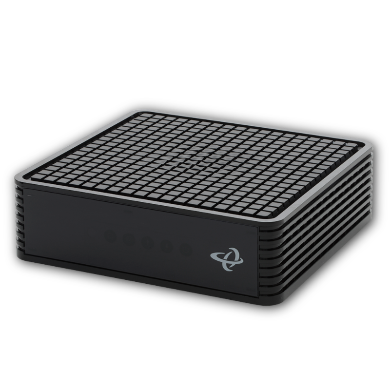

{ width=200 }

# Hitron Modem

_DOCSIS 3.1 Cable Modem_

[Xfinity Account&ensp;:brands-xfinity:](https://login.xfinity.com/login){ .md-button .md-button--primary }&emsp;[OpenSpeedTest&ensp;:services-openspeedtest:](https://openspeedtest.com){.md-button .md-button-primary}&emsp;[User Manual&ensp;:symbols-notebook-text:](../assets/manuals/CODA_User_Manual.pdf){ .md-button .md-button--primary }

---

{ width=400 align=right .no-shadow }

## :symbols-info:&ensp;Device Overview

The DOCSIS 3.1 cable modem that communicates with the ISP _([Xfinity](https://www.xfinity.com/overview){ external-link })_. Located in the 10-inch server rack.

&ensp;

**OS / Firmware**

:    Hitron FW&ensp;{ style='vertical-align: middle;' }

**Credentials**

:    N/A

### :symbols-map-pin:&ensp;Location

- <!-- material/tags { include: [Living Room, Server Rack] } -->
{ .no-bullets }

## :symbols-network:&ensp;Network Configuration

| Interface { data-sort-method="number" }                                                                                     | IP Address { data-sort-method="dotsep" } | MAC Address         | Connected To                                                                           |
| :-------------------------------------------------------------------------------------------------------------------------- | :--------------------------------------- | :------------------ | :------------------------------------------------------------------------------------- |
| LAN 1&ensp;{ style='vertical-align: middle;' } | `192.168.100.1`                          | `00:1c:73:00:00:99` | [:symbols-router:&nbsp;ASUS RT-BE92U](asus_rt-be92u.md#wan-connection){ data-preview } |
| LAN 2                                                                                                                       | `Unused`                                 | `-`                 | -                                                                                      |

---

## :symbols-sticky-notes:&ensp;Maintenance & Notes

!!! config "Critical Configurations"

    :symbols-globe-off:&ensp;**WAN Down**

    :   If WAN connection goes down, unplug power from modem for 60-seconds to reboot.

    :symbols-monitor-cog:&ensp;**Access WebUI**

    :   To access the modem's Web UI enter `https://192.168.100.1`.
