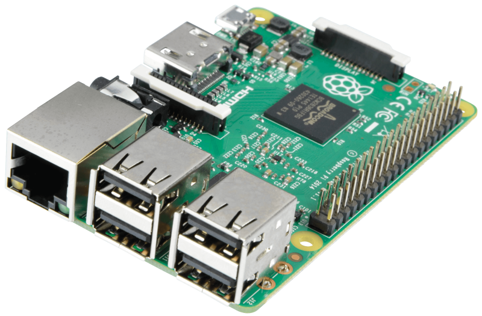

{ width=200 }
{ width=200 }

# Pi 4B Server

_Secondary DNS Server_

[Raspberry Pi Docs&ensp;:brands-raspberry-pi:](https://www.raspberrypi.com/documentation){ .md-button .md-button--primary }&emsp;[Debian Docs&ensp;:brands-debian:](https://www.debian.org/doc/){ .md-button .md-button--primary }

---

{ width=400 align=right .no-shadow }

## :symbols-info:&ensp;Device Overview

The secondary DNS server in the [Technitium](../03_services/technitium.md#overview){ data-preview } cluster, a CUPS print server, a Home Assistant server, and host for other [Docker](https://www.docker.com/){ external-link } containers. Located next to the Ai-Mesh node on the stationary printer cart in the office upstairs, and connected to the local network through the [TP-Link Switch](tp-link_switch.md#physical-overview){ data-preview }.

&ensp;

**Hostname**

- `pi-server` _(VLAN50 / `eth0`)_
{ .no-bullets }
- `home-assistant` _(VLAN53 / `wlan0`)_
{ .no-bullets }

**OS / Firmware**

:    [:brands-debian:&ensp;Debian Linux](https://www.debian.org/distrib/ "Download Debian"){ external-link }&ensp;{ style="vertical-align: middle;" }

**Credentials**

:    [:services-bitwarden:&ensp;Bitwarden](https://vault.bitwarden.com "Bitwarden Web Vault"){ external-link }

    - SSH Keys&ensp;:symbols-move-right:&ensp;"Pi 4B Server (admin)"

### :symbols-map-pin:&ensp;Location

- <!-- material/tags { include: [Office, Printer Cart] } -->
{ .no-bullets }

### :symbols-circuit-board:&ensp;Core Specs

| CPU                                   | Cores / Threads        | CPU Freq. | RAM                       | GPU             | GPU Freq. | VRAM     |
| :------------------------------------ | :--------------------- | :-------- | :------------------------ | :-------------- | :-------- | :------- |
| :brands-arm:&nbsp;BCM2711 _(Armv8-A)_ | 4C / 4T _(Cortex-A72)_ | 1.5 GHz   | 4 GB LPDDR4 _(2400 MT/s)_ | VideoCore VI 3D | 500 MHz   | _Shared_ |

## :symbols-network:&ensp;Network Configuration

| Interface                                                                                                                     | IP Address { data-sort-method="dotsep" } | MAC Address         | Connected To                                                                                                 |
| :---------------------------------------------------------------------------------------------------------------------------- | :--------------------------------------- | :------------------ | :----------------------------------------------------------------------------------------------------------- |
| `eth0`&ensp;{ style='vertical-align: middle;' }   | `192.168.50.2`                           | `E4:5F:01:A4:60:07` | [:symbols-ethernet-port:&nbsp;TP-Link Switch](tp-link_switch.md#port-map){ data-preview } _(port 3, VLAN50)_ |
| `wlan0`&ensp;{ style='vertical-align: middle;' } | `192.168.53.2`                           | `E4:5F:01:A4:60:08` | [:symbols-wifi-lock:&nbsp;2G_IoT](asus_rt-be92u.md#wi-fi-networks){ data-preview } _(VLAN53)_                |

| Interface | VLAN { data-sort-method="number" } | FQDN                 | DNS Servers { data-sort-method="dotsep" } | Gateway { data-sort-method="dotsep" } |
| :-------- | :--------------------------------- | :------------------- | :---------------------------------------- | :------------------------------------ |
| `eth0`    | :symbols-shield:&nbsp;VLAN50       | `pi-server.internal` | `127.0.0.1`                               | `192.168.50.1`                        |
| `wlan0`   | :symbols-shield-house:&nbsp;VLAN53 | `-`                  | `127.0.0.1`                               | `192.168.53.1`                        |

## :symbols-folder-tree:&ensp;Storage & Mounts

### :symbols-hard-drive:&ensp;Internal Drive(s)

| Mount Point      | Drive Type | Drive Capacity { data-sort-method="filesize" } | Device Path      | File System | Encryption |
| :--------------- | :--------- | :--------------------------------------------- | :--------------- | :---------- | :--------- |
| `/`              | MicroSD    | 117 GB                                         | `/dev/mmcblk0p2` | `ext4`      | -          |
| `/boot/firmware` | MicroSD    | 512 MB                                         | `/dev/mmcblk0p1` | `vfat`      | -          |
| `/var/log`       | RAM        | 128 MB                                         | `log2ram`        | `tmpfs`     | -          |

### :symbols-usb:&ensp;External / Attached

| Mount Point      | Drive Type      | Drive Capacity { data-sort-method="filesize" } | Device Path | File System | Encryption |
| :--------------- | :-------------- | :--------------------------------------------- | :---------- | :---------- | :--------- |
| `/mnt/usb-drive` | USB Flash Drive | 28.7 GB                                        | `/dev/sda1` | `ext4`      | -          |

## :symbols-cloud:&ensp;Services & Containers

### :symbols-tux:&ensp;Native Linux

| Service                                                                | Port(s) { data-sort-method="number" } | Status                                                                                                              | Role / Notes { data-sort-method="none" }                                                        |
| :--------------------------------------------------------------------- | :-----------------------------------: | :------------------------------------------------------------------------------------------------------------------ | :---------------------------------------------------------------------------------------------- |
| [:symbols-printer:&nbsp;CUPS](../03_services/cups_print_server.md)     |                 `631`                 | { style='vertical-align: middle;' }     | A standards-based, open-source printing system for Linux and other Unix-like operating systems. |
| [:symbols-square-terminal:&nbsp;SSH](../03_services/ssh.md)            |                 `22`                  | { style='vertical-align: middle;' }       | Provides secure encrypted communications between two untrusted hosts over an insecure network.  |
| [:symbols-folder-tree:&nbsp;SMB](../03_services/smb.md)                |                 `445`                 | { style='vertical-align: middle;' }      | Remote file system access.                                                                      |
| [:services-syncthing-alt:&nbsp;Syncthing](../03_services/syncthing.md) |     `8384` `22000` `21027`      | { style='vertical-align: middle;' } | Open decentralized file synchronization.                                                        |
| [:services-technitium:&nbsp;Technitium](../03_services/technitium.md)  |        `53` `443` `5380`        | { style='vertical-align: middle;' }    | An open-source authoritative as well as recursive DNS server.                                   |

### :symbols-container:&ensp;Docker Container

| Service                                                                            | Port(s) { data-sort-method="number" } | Status                                                                                                                  | Role / Notes { data-sort-method="none" }                                                                  |
| :--------------------------------------------------------------------------------- | :-----------------------------------: | :---------------------------------------------------------------------------------------------------------------------- | :-------------------------------------------------------------------------------------------------------- |
| [:services-beszel:&nbsp;Beszel Hub](../03_services/beszel.md)                      |           `8090` `45876`           | { style='vertical-align: middle;' }        | A lightweight server monitoring hub with historical data, docker stats, and alerts.                       |
| [:services-cloudflare-zero-trust:&nbsp;Cloudflared](../03_services/cloudflared.md) |                `60123`                | { style='vertical-align: middle;' }   | Secure reverse-proxy tunnel for hosting private services on the public internet.                          |
| [:services-dockge:&nbsp;Dockge](../03_services/dockge.md)                          |                `5001`                 | { style='vertical-align: middle;' }        | A fancy, easy-to-use and reactive self-hosted Docker `compose.yaml` stack-oriented manager.               |
| [:services-glance:&nbsp;Glance (Stack)](../03_services/glance.md)                  |      `8580` `4463` `9090`       | { style='vertical-align: middle;' }        | A self-hosted dashboard that puts all your feeds in one place.                                            |
| [:services-glances:&nbsp;Glances](../03_services/glances.md)                       |                `61208`                | { style='vertical-align: middle;' }       | A `top` / `htop` alternative for GNU / Linux, BSD, Mac OS and Windows operating systems.                  |
| [:services-home-assistant:&nbsp;Home Assistant](../03_services/home_assistant.md)  |                `8123`                 | { style='vertical-align: middle;' } | Open-source home automation that puts local control and privacy first.                                    |
| [:services-it-tools:&nbsp;IT-Tools](../03_services/it-tools.md)                    |           `8000` `8080`            | { style='vertical-align: middle;' }     | Collection of handy online tools for developers, with great UX.                                           |
| [:brands-matter:&nbsp;Matter Server](../03_services/matter_server.md)              |                `5580`                 | { style='vertical-align: middle;' }        | Serves as the foundation to provide Matter support to [Home Assistant](../03_services/home_assistant.md). |
| [:services-portracker:&nbsp;Portracker](../03_services/portracker.md)              |                `4999`                 | { style='vertical-align: middle;' }    | A self-hosted, real-time port monitoring and discovery tool.                                              |
| [:services-uptime-kuma:&nbsp;Uptime Kuma](../03_services/uptime_kuma.md)           |                `3001`                 | { style='vertical-align: middle;' }  | A fancy self-hosted monitoring tool.                                                                      |

---

## :symbols-sticky-notes:&ensp;Maintenance & Notes

--8<-- "maintenance-raspi.md"
