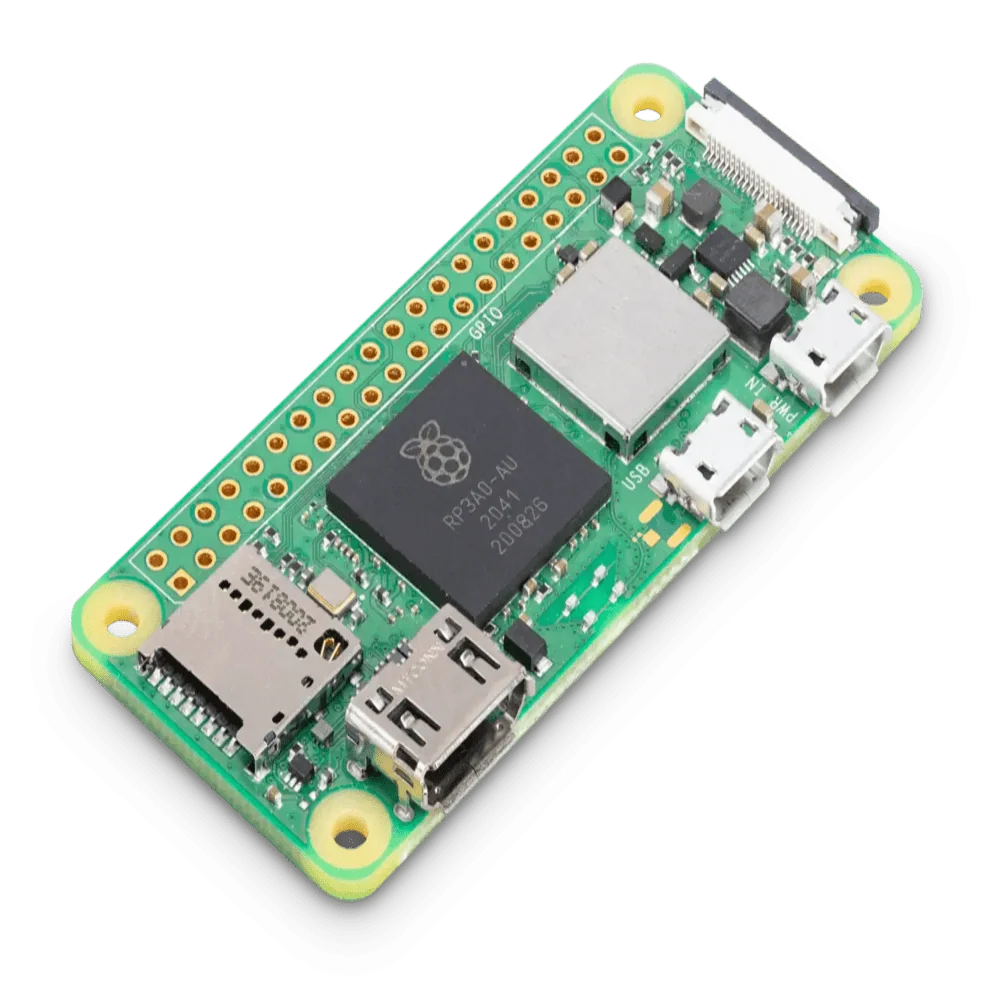

{ width=200 }
{ width=200 }

# Pi Zero 2W Server

_Reverse-Proxy Server_

[Raspberry Pi Docs&ensp;:brands-raspberry-pi:](https://www.raspberrypi.com/documentation){ .md-button .md-button--primary }&emsp;[Debian Docs&ensp;:brands-debian:](https://www.debian.org/doc/){ .md-button .md-button--primary }

---

{ width=400 align=right .no-shadow }

## :symbols-info:&ensp;Device Overview

A tiny, low-power server acting as a dedicated as Caddy reverse-proxy, giving unique `.internal` FQDNs to services hosted on the local network. Located on the stationary printer cart in the office upstairs, and connected to the local network via 2.4 GHz Wi-Fi _(SSID: `Home`)_.

&ensp;

**Hostname**

:    `pi-zero`

**OS / Firmware**

:    [:brands-debian:&ensp;Debian Linux](https://www.debian.org/distrib/ "Download Debian"){ external-link }&ensp;{ style="vertical-align: middle;" }

**Credentials**

:    [:services-bitwarden:&ensp;Bitwarden](https://vault.bitwarden.com "Bitwarden Web Vault"){ external-link }

    - SSH Keys&ensp;:symbols-move-right:&ensp;"Pi Zero Server (admin)"

### :symbols-map-pin:&ensp;Location

- <!-- material/tags { include: [Office, Printer Cart] } -->
{ .no-bullets }

### :symbols-circuit-board:&ensp;Core Specs

| CPU                                  | Cores / Threads        | CPU Freq. | RAM          | GPU          | GPU Freq. | VRAM     |
| :----------------------------------- | :--------------------- | :-------- | :----------- | :----------- | :-------- | :------- |
| :brands-arm:&nbsp;BCM2837 _(Armv-8)_ | 4C / 4T _(Cortex-A53)_ | 1.2 GHz   | 512 MB SDRAM | VideoCore IV | 400 MHz   | _Shared_ |

## :symbols-network:&ensp;Network Configuration

| Interface                                                                                                                     | IP Address { data-sort-method="dotsep" } | MAC Address         | Connected To                                                                                |
| :---------------------------------------------------------------------------------------------------------------------------- | :--------------------------------------- | :------------------ | :------------------------------------------------------------------------------------------ |
| `wlan0`&ensp;{ style='vertical-align: middle;' } | `192.168.50.3`                           | `2c:cf:67:db:f5:e2` | [:symbols-wifi-lock:&nbsp;Home](asus_rt-be92u.md#wi-fi-networks){ data-preview } _(VLAN50)_ |

| Interface | VLAN { data-sort-method="number" } | FQDN               | DNS Servers { data-sort-method="dotsep" } | Gateway { data-sort-method="dotsep" } |
| :-------- | :--------------------------------: | :----------------- | :---------------------------------------- | :------------------------------------ |
| `wlan0`   |    :symbols-shield:&nbsp;VLAN50    | `pi-zero.internal` | `192.168.50.6` `192.168.50.2`             | `192.168.50.1`                        |

## :symbols-folder-tree:&ensp;Storage & Mounts

### :symbols-hard-drive:&ensp;Internal Drive(s)

| Mount Point      | Drive Type | Drive Capacity { data-sort-method="filesize" } | Device Path      | File System | Encryption |
| :--------------- | :--------- | :--------------------------------------------- | :--------------- | :---------- | :--------- |
| `/`              | MicroSD    | 29 GB                                          | `/dev/mmcblk0p2` | `ext4`      | -          |
| `/boot/firmware` | MicroSD    | 512 MB                                         | `/dev/mmcblk0p1` | `vfat`      | -          |
| `/var/log`       | RAM        | 80 MB                                          | `log2ram`        | `tmpfs`     | -          |

## :symbols-cloud:&ensp;Services & Containers

### :symbols-tux:&ensp;Native Linux

| Service                                                                | Port(s) { data-sort-method="number" } | Status                                                                                                              | Role / Notes { data-sort-method="none" }                                                       |
| :--------------------------------------------------------------------- | :-----------------------------------: | :------------------------------------------------------------------------------------------------------------------ | :--------------------------------------------------------------------------------------------- |
| [:services-caddy:&nbsp;Caddy](../03_services/caddy.md)                 |             `80` `443`             | { style='vertical-align: middle;' }    | Used as a _reverse-proxy_ for creating unique domains for locally hosted services.             |
| [:symbols-square-terminal:&nbsp;SSH](../03_services/ssh.md)            |                 `22`                  | { style='vertical-align: middle;' }       | Provides secure encrypted communications between two untrusted hosts over an insecure network. |
| [:services-syncthing-alt:&nbsp;Syncthing](../03_services/syncthing.md) |     `8384` `22000` `21027`      | { style='vertical-align: middle;' } | Open decentralized file synchronization.                                                       |

### :symbols-container:&ensp;Docker Container

| Service                                                                     | Port(s) { data-sort-method="number" } | Status                                                                                                                  | Role / Notes { data-sort-method="none" }                                                             |
| :-------------------------------------------------------------------------- | :-----------------------------------: | :---------------------------------------------------------------------------------------------------------------------- | :--------------------------------------------------------------------------------------------------- |
| [:services-beszel:&nbsp;Beszel](../03_services/beszel.md)                   |                `45876`                | { style='vertical-align: middle;' }        | Agent for Beszel Hub *(hosted on [Pi 4B Server](pi_4b_server.md#docker-container){ data-preview })*. |
| [:services-docker-proxy:&nbsp;Docker Proxy](../03_services/docker-proxy.md) |                `2375`                 | { style='vertical-align: middle;' } | Proxy over your Docker socket to restrict which requests it accepts.                                 |
| [:services-dockge:&nbsp;Dockge](../03_services/dockge.md)                   |                `5001`                 | { style='vertical-align: middle;' }        | A fancy, easy-to-use and reactive self-hosted Docker `compose.yaml` stack-oriented manager.          |

---

## :symbols-sticky-notes:&ensp;Maintenance & Notes

--8<-- "maintenance-raspi.md"
