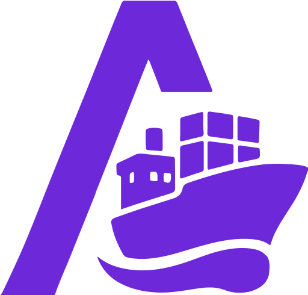

{ width=200 }

# Arcane

_Docker Management_

[GitHub&ensp;:brands-github:](https://github.com/getarcaneapp/arcane){ .md-button .md-button--primary }&emsp;[Google Play&ensp;:brands-google-play:](https://play.google.com/store/apps/details?id=app.getarcane.android){.md-button .md-button--primary}&emsp;[Documentation&ensp;:symbols-files:](https://getarcane.app/docs){ .md-button .md-button--primary }

---

{ width=400 align=right .on-glb }
{ width=400 align=right .on-glb }

## :symbols-info:&ensp;Overview

Modern Docker management, designed for everyone. A comprehensive set of tools to handle every aspect of your container infrastructure.

&ensp;&ensp;

**Port(s)**

- `3552` &ndash; _Manager_
{ .no-bullets }
- `3553` &ndash; _Agents_
{ .no-bullets }

**URL / Access**

- <http://storage-server.internal:3552>
{ .no-bullets }
- <http://storage-server-2.internal:3552>
{ .no-bullets }

**Credentials**

-   [:services-authentik:&ensp;Authentik OAuth](https://auth.rac3r4life.online){ external-link }
{ .no-bullets }
-   [:services-bitwarden:&ensp;Bitwarden](https://vault.bitwarden.com "Bitwarden Web Vault"){ external-link }
{ .no-bullets }
    - Local Network&ensp;:symbols-move-right:&ensp;"Arcane (admin)"

## :symbols-package-search:&ensp;Deployment Details

| Host Device                                                            | Method                                    | Container Name      | Image                                 | Status                                                                                                           | Port(s) |
| :--------------------------------------------------------------------- | :---------------------------------------- | :------------------ | :------------------------------------ | :--------------------------------------------------------------------------------------------------------------- | :------ |
| [:symbols-layers:&nbsp;Debian Server](../02_hardware/debian_server.md) | :symbols-container:&nbsp;Docker Container | `arcane-edge-agent` | `ghcr.io/getarcaneapp/agent:latest`   | { style='vertical-align: middle;' } | `3553`  |
| [:symbols-server:&nbsp;Pi 4B Server](../02_hardware/pi_4b_server.md)   | :symbols-container:&nbsp;Docker Container | `arcane-edge-agent` | `ghcr.io/getarcaneapp/agent:latest`   | { style='vertical-align: middle;' } | `3553`  |
| [:symbols-server-nas:&nbsp;ZimaOS NAS](../02_hardware/zimaos_nas.md)   | :symbols-container:&nbsp;Docker Container | `arcane`            | `ghcr.io/getarcaneapp/manager:latest` | { style='vertical-align: middle;' } | `3552`  |

---

## :symbols-settings:&ensp;Configuration

### :symbols-folder-git-2:&ensp;Data Directories

#### Manager

| Contents            | Path                                      |
| :------------------ | :---------------------------------------- |
| Docker Compose File | `/DATA/.casaos/apps/arcane/compose.yaml`  |
| App Data            | `arcane-data` &ndash; _Docker volume_     |
| Build Data          | `arcane-builds` &ndash; _Docker volume_   |
| Backup Data         | `/media/nvme0n1p1/AppData/arcane-backups` |
| Projects Data       | `/media/nvme0n1p1/AppData/dockge/stacks`  |

#### Agents

| Contents            | Path                                     |
| :------------------ | :--------------------------------------- |
| Docker Compose File | `/opt/arcane/compose.yaml`               |
| App Data            | `arcane-data` &ndash; _Docker volume_    |
| Build Data          | `arcane-builds` &ndash; _Docker volume_  |
| Backup Data         | `arcane-backups` &ndash; _Docker volume_ |
| Projects Data       | `/opt/stacks`                            |

### :symbols-file-code-corner:&ensp;Docker Compose Files

#### Manager

``` yaml { .mono-title title="/DATA/.casaos/apps/arcane/compose.yaml" } 
--8<-- "arcane-manager.yaml"
```

#### Agents

``` yaml { .mono-title title="/opt/arcane/compose.yaml" } 
--8<-- "arcane-agents.yaml"
```

### :symbols-cloud-upload:&ensp;Data Backup

Arcane can back up your Docker volumes and its own data _(database, settings, and runtime configuration)_, on demand or on a schedule. Backups are stored on local storage mounted at `/backups`, in an S3-compatible bucket, or in both. For this configuration the data is backed up to both the local `/backups` directory and [Backblaze B2](https://www.backblaze.com/){ external-link } cloud storage in the `Arcane-Docker-Bkp` bucket.

Backups are encrypted snapshots made with [Rustic](https://rustic.cli.rs/){ external-link }, an open-source backup tool that Arcane runs in short-lived containers. Before your first backup, set up storage and a recovery key.

#### Configure S3 Storage

1. Open **Settings**&ensp;:symbols-move-right:&ensp;**Backups**&ensp;:symbols-move-right:&ensp;**S3 Destinations**.
2. Enter the connection details.&ensp;_(see [S3 Destination Fields](https://getarcane.app/docs/docker/backups#s3-destination-fields){ external-link } in Arcane docs)_
3. Test the destination. **Create** and **Save** need a passing test, which writes, downloads, verifies, and deletes a temporary object.
4. Save the configuration

!!! note

    Destinations sync from the manager to all remote environments. When you change the endpoint, bucket, region, access key ID, SSL, or path-style setting, re-enter the secret access key and test again. A destination can’t be deleted while a schedule or a retained remote backup still uses it.

#### Recovery Key

The recovery key encrypts system backups and volume backups. Without it, snapshots can’t be restored, so keep a copy outside Arcane. The recovery key is currently stored in the [Bitwarden](https://vault.bitwarden.com){ external-link } vault, inside the **Local Network**&ensp;:symbols-move-right-bold:&ensp;**"Arcane (admin)"** entry.

1. Open **Settings**&ensp;:symbols-move-right:&ensp;**Backups**&ensp;:symbols-move-right:&ensp;**Recovery key** and choose **"Create recovery key"**.
2. Copy the key and store it somewhere outside Arcane. It isn’t shown again. _(see [Bitwarden](https://vault.bitwarden.com){ external-link } vault entry)_
3. Confirm the key to save it.

!!! tip

    Arcane keeps a copy for scheduled jobs. To use a key from another installation, choose **"Import recovery key"** instead. To replace the key, choose **"Reset recovery key"**.

!!! warning

    Losing the recovery key makes the snapshots unrecoverable. Arcane refuses to reset the key while system backups made with the current key still exist, because they can only be opened with the key that created them.

    Volume backups made before any recovery key was set use a password derived from `ENCRYPTION_KEY`. When you set a recovery key, Arcane tries to move its existing volume backup repositories to the new key. Repositories that belong to another Arcane instance must be moved by that instance.

    Keep your original `ENCRYPTION_KEY` until you’ve confirmed older volume backups open with the recovery key. A recovery key imported on a fresh installation can’t unlock a repository that still uses the old password.

#### Create Backup

Click **"Create Backup"** for a local backup, or open its dropdown and choose **Local**, **S3**, or **Local + S3**. Options that include S3 ask which saved destination to use. The table shows each run’s trigger, destination, size, time, and status. Failed runs show their error and can’t be restored. Only one backup, upload, or delete can run on a volume at a time.

From a successful backup’s row actions you can:

- **Upload to S3:** copy a local backup to a destination, turning it into a Local + S3 backup.
- Download it as a `tar.gz` archive.

#### Schedule Backups

Click Add schedule. A volume can have several schedules, each with these settings:

| Setting         | Action                                                                                                                    |
| :-------------- | :------------------------------------------------------------------------------------------------------------------------ |
| Enabled         | Turns the schedule on or off.                                                                                             |
| Schedule        | Six-field cron expression with seconds, in Arcane’s configured timezone.&ensp;_(e.g., `0 0 2 * * *` runs daily at 02:00)_ |
| Backups to keep | How many restore points to keep, `0` to `3650`.&ensp;_(`0` keeps all of them)_                                            |
| Destination     | **Local**, **S3**, or **Local + S3**. If S3 is included, also pick the S3 destination.                                    |
| Stop containers | Stops running containers that use the volume, takes the snapshot, then starts them again.                                 |

!!! tip

    Turn on **"Stop containers during backup"** for applications that write to the volume constantly, such as databases; otherwise the restore point may be inconsistent. Leaving it off avoids downtime. On-demand **Create Backup** never stops containers.

    Scheduled and on-demand runs appear in the same table and in the Activity Center.

<figure markdown="span">
    { .on-glb width=500 }
    { .on-glb width=500 }
<figcaption>Choose when to back up a volume, how many snapshots to keep, and where to store them.</figcaption>
</figure>
