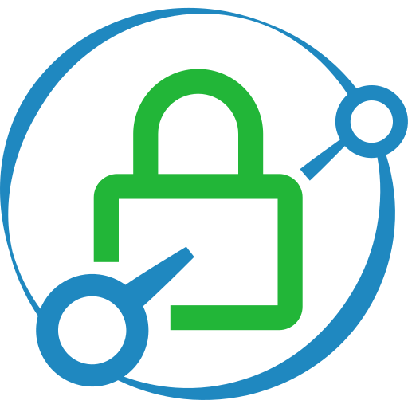

{ width=200 }

# Caddy

_Reverse-Proxy Server_

[GitHub&ensp;:brands-github:](https://github.com/caddyserver/caddy){ .md-button .md-button--primary }&emsp;[Documentation&ensp;:symbols-files:](https://caddyserver.com/docs/){ .md-button .md-button--primary }

---

{ width=400 align=right .on-glb }
{ width=400 align=right .on-glb }

## :symbols-info:&ensp;Overview

Lightweight, open-source Web server written in Go. Used as a _reverse-proxy_ for creating unique domains for locally hosted services.

&ensp;&ensp;

**Port(s)**

- `80`
{ .no-bullets }
- `443`
{ .no-bullets }

**URL / Access**

- <http://pi-zero.internal:80>
{ .no-bullets }
- <https://pi-zero.internal:443>
{ .no-bullets }

**Credentials**

:    N/A

## :symbols-package-search:&ensp;Deployment Details

| Host Device                                                                    | Method                                      | Container Name | Image | Status                                                                                                           | Port(s)         |
| :----------------------------------------------------------------------------- | :------------------------------------------ | :------------- | :---- | :--------------------------------------------------------------------------------------------------------------- | :-------------- |
| [:symbols-server:&nbsp;Pi Zero 2W Server](../02_hardware/pi_zero_2w_server.md) | :symbols-tux:&nbsp;Native Linux _(Systemd)_ | `-`            | `-`   | { style='vertical-align: middle;' } | `80`&ensp;`443` |

---

## :symbols-settings:&ensp;Configuration

### :symbols-monitor-arrow-down-corner:&ensp;Install

1.  Add the official Caddy repository.

    ``` bash linenums="1"
    sudo apt install -y debian-keyring debian-archive-keyring apt-transport-https curl
    
    curl -1sLf 'https://dl.cloudsmith.io/public/caddy/stable/gpg.key' | sudo gpg --dearmor -o /usr/share/keyrings/caddy-stable-archive-keyring.gpg
    
    curl -1sLf 'https://dl.cloudsmith.io/public/caddy/stable/debian.deb.txt' | sudo tee /etc/apt/sources.list.d/caddy-stable.list
    ```

2.  Install the package.

    ``` bash linenums="1"
    sudo apt update
    sudo apt install caddy
    ```

3.  Edit the configuration.

    ``` bash linenums="1"
    sudo nano /etc/caddy/Caddyfile
    ```

4.  Apply configuration changes by reloading the Systemd service.

    ``` bash linenums="1"
    sudo systemctl reload caddy
    ```

### :symbols-file-cog:&ensp;The 'Caddyfile'

``` nginx { .mono-title title="/etc/caddy/Caddyfile" linenums="1" }
--8<-- "Caddyfile"
```

1. Set this path to your site's directory.
2. Enable the static file server.
3. Another common task is to set up a reverse proxy.
4. Or serve a PHP site through php-fpm.
5. Refer to the [Caddy Docs](https://caddyserver.com/docs/caddyfile){ external-link } for more information.
