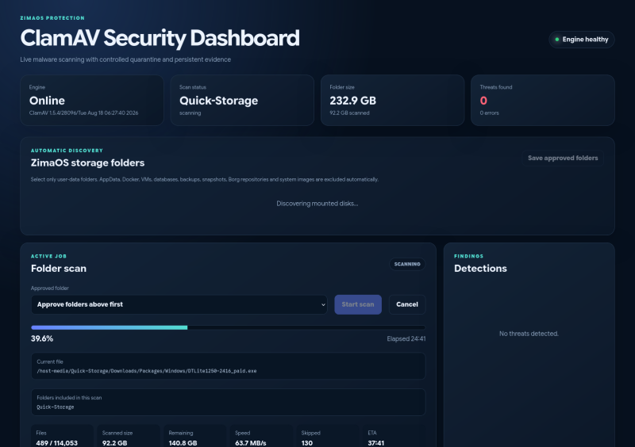

{ width=200 }

# ClamAV Dashboard

_Anti-Virus for ZimaOS_

[GitHub&ensp;:brands-github:](https://github.com/Jacko88888/clamav-dashboard){ .md-button .md-button--primary }&emsp;[Issues&ensp;:symbols-circle-dot-dashed:](https://github.com/Jacko88888/clamav-dashboard/issues){ .md-button .md-button--primary }

---

{ width=400 align=right .on-glb }

## :symbols-info:&ensp;Overview

Anti-virus security dashboard for ZimaOS with automatic disk discovery, scan progress, history and confirmed quarantine actions.

&ensp;&ensp;

**Port(s)**

-   Container:&ensp;`clamav-server`
{ .no-bullets }
    - `3310`
-   Container:&ensp;`clamav-dashboard`
{ .no-bullets }
    - `8099`

**URL / Access**

:    <http://storage-server.internal:8099>

**Credentials**

:    N/A

## :symbols-package-search:&ensp;Deployment Details

| Host Device                                                          | Method                                    | Container Name     | Image                                       | Status                                                                                                          | Port(s) |
| :------------------------------------------------------------------- | :---------------------------------------- | :----------------- | :------------------------------------------ | :-------------------------------------------------------------------------------------------------------------- | :------ |
| [:symbols-server-nas:&nbsp;ZimaOS-NAS](../02_hardware/zimaos_nas.md) | :symbols-container:&nbsp;Docker Container | `clamav-server`    | `clamav/clamav:1.5_base`                    | { style='vertical-align: middle;' } | `3310`  |
| -                                                                    | :symbols-container:&nbsp;Docker Container | `clamav-dashboard` | `ghcr.io/jacko88888/clamav-dashboard:0.2.4` | { style='vertical-align: middle;' } | `8099`  |

## :symbols-settings:&ensp;Configuration

--8<-- "managed-by-arcane.md"

### :symbols-folder-git-2:&ensp;Data Directories

| Contents              | Path                                                                   |
| :-------------------- | :--------------------------------------------------------------------- |
| Docker Compose File   | `/media/nvme0n1p1/AppData/dockge/stacks/clamav-dashboard/compose.yaml` |
| ClamAV Server Data    | `/media/nvme0n1p1/AppData/dockge/stacks/clamav-dashboard/clamav`       |
| ClamAV Dashboard Data | `/media/nvme0n1p1/AppData/dockge/stacks/clamav-dashboard/data`         |

### :symbols-file-code-corner:&ensp;Docker Compose File

``` yaml { .mono-title title="../AppData/dockge/stacks/clamav-dashboard/compose.yaml" linenums="1" }
--8<-- "clamav-dashboard.yaml"
```
