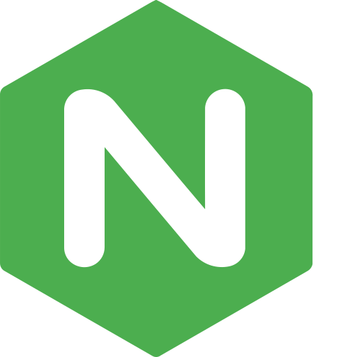

{ width=200 }

# Nginx

_Network Documentation_

[GitHub&ensp;:brands-github:](https://github.com/nginx/nginx){ .md-button .md-button--primary }&emsp;[Documentation&ensp;:symbols-files:](https://nginx.org/en/docs/){ .md-button .md-button--primary }

---

{ width=400 align=right .on-glb }
{ width=400 align=right .on-glb }

## :symbols-info:&ensp;Overview

The world's most popular Web Server, high performance Load Balancer, Reverse Proxy, API Gateway and Content Cache. This Nginx server is a Docker container with read-only access to the single directory containing the website. It hosts the very **"Network Documentation & Portfolio"** website you are browsing now.

&ensp;&ensp;&ensp;

**Port(s)** 

:    `8080`

**URL / Access**

- <http://storage-server.internal:8080>
{ .no-bullets }
- <http://storage-server-2.internal:8080>
{ .no-bullets }
- <https://portfolio.rac3r4life.online>
{ .no-bullets }

**Credentials**

:    [:services-bitwarden:&ensp;Bitwarden](https://vault.bitwarden.com "Bitwarden Web Vault"){ external-link }

    - SSH Keys&ensp;:symbols-move-right:&ensp;"ZimaOS NAS (admin)"

## :symbols-package-search:&ensp;Deployment Details

| Host Device                                                          | Method                                    | Container Name          | Image          | Status                                                                                                          | Port(s) |
| :------------------------------------------------------------------- | :---------------------------------------- | :---------------------- | :------------- | :-------------------------------------------------------------------------------------------------------------- | :------ |
| [:symbols-server-nas:&nbsp;ZimaOS NAS](../02_hardware/zimaos_nas.md) | :symbols-container:&nbsp;Docker Container | `network-documentation` | `nginx:alpine` | { style='vertical-align: middle;' } | `8080`  |

---

## :symbols-settings:&ensp;Configuration

--8<-- "managed_by_dockge.md"

### :symbols-folder-git-2:&ensp;Data Directories

| Contents            | Path                                                                    |
| :------------------ | :---------------------------------------------------------------------- |
| Docker Compose File | `/media/nvme0n1p1/AppData/dockge/stacks/network-portfolio/compose.yaml` |
| Nginx Config File   | `/media/nvme0n1p1/AppData/Network-Portfolio/default.conf`               |
| Site Data           | `/media/nvme0n1p1/AppData/Network-Portfolio/site`                       |

### :symbols-file-cog:&ensp;Config File

``` nginx { .mono-title title="../AppData/Network-Portfolio/default.conf" linenums="1" }
--8<-- "nginx.conf"
```

1. Pull in standard MIME types, then explicitly define `.mjs`
2. Redirect server error pages to the static page `/50x.html`

### :symbols-file-code-corner:&ensp;Docker Compose File

``` yaml { .mono-title title="../AppData/dockge/stacks/network-documentation-portfolio/compose.yaml" linenums="1" }
--8<-- "nginx.yml"
```

1. Maps port `8080` on the VM to port `80` inside the container.
2. Mounts your site folder as read-only (ro) for extra security.
3. Mounts your site folder as read-only (ro) for extra security.

### :symbols-cloud-upload:&ensp;Deploy Site Manually

After building the site with the `zensical build` command on the client PC, the `/site` directory will be created in the repository directory. To deploy the built website, the `/site` directory needs to be copied to the server. This is accomplished most efficiently using the `scp` or `rsync` commands and the SSH protocol. The benefit of using `rsync` is a faster transfer and less write cycles on the NVMe SSD. This is because `rsync` will only copy the files that have changed, while `scp` copies everything and overwrites the existing files.

#### Using `scp`

1.  Ensure the `../AppData/Network-Portfolio` directory has the correct permissions.

    ``` text
    drwxr-xr-x 11 admin admin 4096 Nov  8 07:37 Network-Portfolio
    ```

2.  Run the `scp` command to copy the files.

    ``` bash
    scp -r /home/bhaube/Development/network-portfolio/site/ admin@ZimaOS-NAS:/media/nvme0n1p1/AppData/Network-Portfolio
    ```

    You will be prompted by the [Bitwarden](https://vault.bitwarden.com "Bitwarden Web Vault"){ external-link } SSH key agent to approve sending the private key.

#### Using `rsync`

1.  Ensure the `../AppData/Network-Portfolio` directory has the correct permissions.

    ``` text
    drwxr-xr-x 11 admin samba 4096 Nov  8 07:37 Network-Portfolio
    ```

2.  Run the `scp` command to copy the files.

    ``` bash
    rsync -av --delete /home/bhaube/Development/network-portfolio/site/ admin@ZimaOS-NAS:/media/nvme0n1p1/AppData/Network-Portfolio/site
    ```

    You will be prompted by the [Bitwarden](https://vault.bitwarden.com "Bitwarden Web Vault"){ external-link } SSH key agent to approve sending the private key.

### :symbols-circle-fading-arrow-up:&ensp;CI/CD Pipeline

The local [Gitea](gitea.md#overview){ data-preview } server hosting the Network Documentation site's code repository has a built-in feature called [Gitea Actions](https://docs.gitea.com/usage/actions/overview/ "Documentation"){ external-link }, which uses an execution runner _(called `act_runner`)_ that parses almost the exact same YAML syntax as GitHub. The standard, secure way to handle this on a single-server deployment is to have the runner build the site in isolation, and then use SSH / SCP to securely transfer the files from the job container back to the host machine.

#### Enable Actions & Secrets

1.  Go to your `network-portfolio` repository settings in [Gitea](gitea.md) and check the box to Enable Repository Actions.

    { width=500 .on-glb }
    { width=500 .on-glb }

2.  Go to **Settings**&ensp;:symbols-move-right:&ensp;**Actions**&ensp;:symbols-move-right:&ensp;**Secrets** and add the following keys so your workflow can securely access the server:
    - `SERVER_IP` &ndash; _Server's LAN IP address_
    - `SERVER_USER` &ndash; _Server's SSH username_
    - `SSH_PRIVATE_KEY` &ndash; _Server's private SSH key_

    { width=500 .on-glb }
    { width=500 .on-glb }

#### Create Workflow File

1.  In the repository, create the directory structure for `.gitea/workflows` and add a file named `deploy.yaml`.
    - This workflow triggers when you push to the `main` branch, builds the site, then uses SSH to execute the `rsync` command copying it into the site directory.

    ``` yaml { .mono-title title=".gitea/workflows/deploy.yaml" }
    name: Build and Deploy Site

    on:
      push:
        branches:
          - main

    jobs:
      deploy:
        runs-on: ubuntu-latest
        steps:
          - name: Checkout repository
            uses: actions/checkout@v4

          - name: Build the Site
            run: |
              echo "Building site..."
              python -m venv .venv/
              source .venv/bin/activate
              pip install --upgrade --force-reinstall zensical mkdocs-awesome-nav mkdocs-glightbox
              zensical build

          - name: Deploy Site via Rsync over SSH
            env:
              SSH_PRIVATE_KEY: ${{ secrets.SSH_PRIVATE_KEY }}
              SERVER_USER: ${{ secrets.SERVER_USER }}
              SERVER_IP: ${{ secrets.SERVER_IP }}
            run: |
              mkdir -p ~/.ssh
              chmod 700 ~/.ssh
              echo "$SSH_PRIVATE_KEY" > ~/.ssh/id_rsa
              chmod 600 ~/.ssh/id_rsa
              rsync -av --delete -e "ssh -o StrictHostKeyChecking=no -i ~/.ssh/id_rsa" site/ $SERVER_USER@$SERVER_IP:/media/nvme0n1p1/AppData/Network-Portfolio/site/
    ```

2.  Once you commit and push this `deploy.yaml` file to your Gitea repository, the pipeline will immediately kick off. You can monitor the build logs natively inside Gitea under the **"Actions"** tab of your repo.
