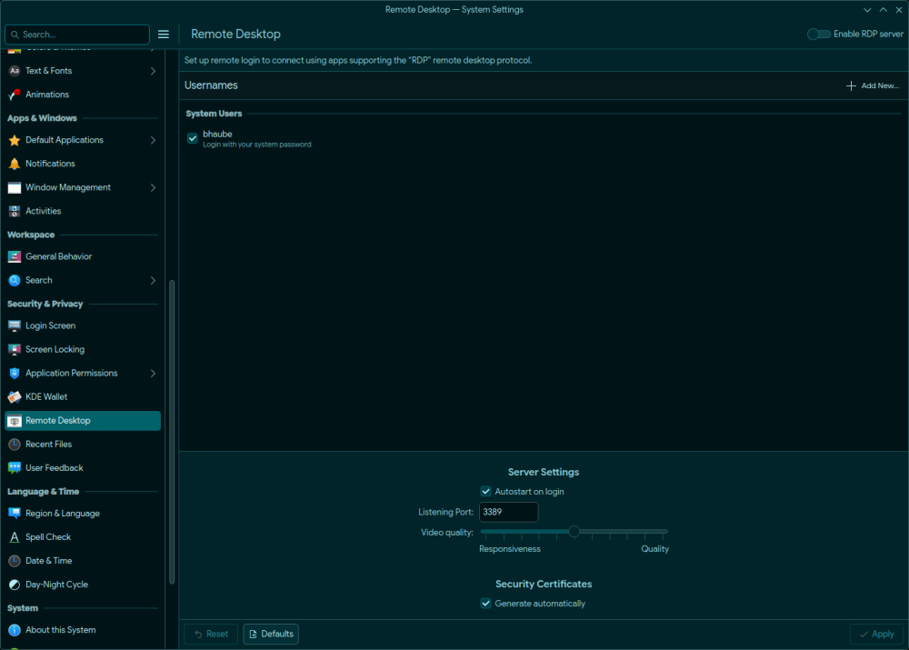

{ width=200 }
{ width=200 }

# RDP

_Remote Desktop Protocol_

[Gitlab&ensp;:brands-gitlab:](https://invent.kde.org/plasma/krdp){ .md-button .md-button--primary }&emsp;[Documentation&ensp;:symbols-files:](https://deepwiki.com/KDE/krdp){ .md-button .md-button--primary }

---

{ width=400 align=right .on-glb }

## :symbols-info:&ensp;Overview

**Description**

:    KRDP is a Remote Desktop Protocol server implementation for the KDE Plasma desktop environment and Wayland-based systems. It enables remote access to a Wayland desktop session using standard RDP clients, leveraging modern Linux desktop technologies including PipeWire for screen capture, XDG Desktop Portals for compositor integration, and FreeRDP for protocol implementation.

**Port(s)**

:    `3389`

**URL / Access**   

:    [rdp://bens-workstation.internal:3389](rdp://192.168.50.67:3389)

**Credentials**

:    [:services-bitwarden:&ensp;Bitwarden](https://vault.bitwarden.com "Bitwarden Web Vault"){ external-link }  

    - Local Network&ensp;:symbols-move-right:&ensp;"Local User @ Ben's-Workstation"

## :symbols-package-search:&ensp;Deployment Details

| Host Device                                                            | Method                          | Container Name | Image | Port(s) |
| :--------------------------------------------------------------------- | :------------------------------ | :------------- | :---- | :------ |
| [:symbols-pc-case:&nbsp;Ben's Desktop](../02_hardware/bens_desktop.md) | :symbols-tux:&nbsp;Native Linux | `N/A`          | `N/A` | `3389`  |

---

## :symbols-settings:&ensp;Configuration

``` ini { .mono-title title="~/.config/krdpserverrc" linenums="1" }
--8<-- "krdpserverrc"
```
