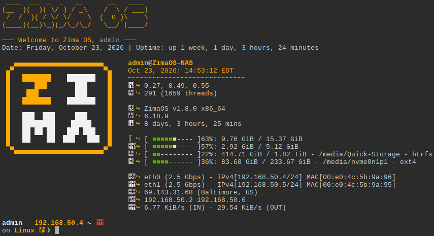

{ width=200 }
{ width=200 }

# ttydBridge

_The Terminal on the Web_

[GitHub&ensp;:brands-github:](https://github.com/Cp0204/ttydBridge){ .md-button .md-button--primary }&emsp;[Documentation&ensp;:symbols-files:](https://deepwiki.com/tsl0922/ttyd){ .md-button .md-button--primary }

---

{ width=400 align=right .on-glb }

## :symbols-info:&ensp;Overview

**Description**

:    A "bridge" to the host environment, allowing you to easily use the host terminal in your browser.

**Port(s)** 

:    `2222`

**URL / Access**

- <http://storage-server.internal:2222>
{ .no-bullets }
- <http://storage-server-2.internal:2222>
{ .no-bullets }

**Credentials**

:    [:services-bitwarden:&ensp;Bitwarden](https://vault.bitwarden.com "Bitwarden Web Vault"){ external-link }

    - Local Network&ensp;:symbols-move-right:&ensp;"ZimaOS NAS (admin)"

## :symbols-package-search:&ensp;Deployment Details

| Host Device                                                          | Method                                    | Container Name | Image                      | Port(s) |
| :------------------------------------------------------------------- | :---------------------------------------- | :------------- | :------------------------- | :------ |
| [:symbols-server-nas:&nbsp;ZimaOS NAS](../02_hardware/zimaos_nas.md) | :symbols-container:&nbsp;Docker Container | `ttydbridge`   | `cp0204/ttydbridge:v0.0.3` | `2222`  |

---

## :symbols-settings:&ensp;Configuration

``` yaml { .mono-title title="~/.casaos/apps/ttydbridge/docker-compose.yml" linenums="1" }
--8<-- "ttydBridge.yml"
```

--8<-- "zima-ssh.md"
