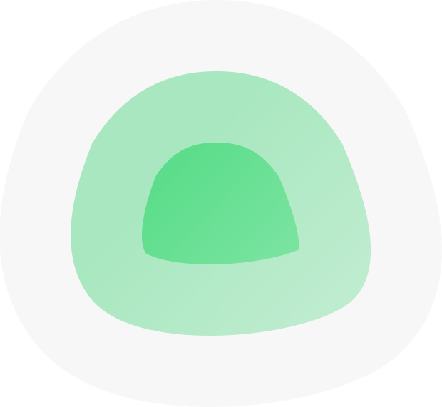

{ width=200 }

# Uptime Kuma

_A Fancy Monitoring Tool_

[GitHub&ensp;:brands-github:](https://github.com/louislam/uptime-kuma){ .md-button .md-button--primary }&emsp;[Documentation&ensp;:symbols-files:](https://github.com/louislam/uptime-kuma/wiki){ .md-button .md-button--primary }

---

{ width=400 align=right .on-glb }
{ width=400 align=right .on-glb }

## :symbols-info:&ensp;Overview

A fancy self-hosted service monitoring tool.

&ensp;&ensp;&ensp;

**Port(s)**

- `2375`
{ .no-bullets }
- `3001`
{ .no-bullets }

**URL / Access**

- <https://uptime.internal>
{ .no-bullets }
- <http://pi-server.internal:3001>
{ .no-bullets }
- <https://uptime.rac3r4life.online>
{ .no-bullets }

**Credentials**

-   [:services-bitwarden:&ensp;Bitwarden](https://vault.bitwarden.com "Bitwarden Web Vault"){ external-link }
{ .no-bullets }
    - Local Network&ensp;:symbols-move-right:&ensp;"Uptime Kuma"
-   2FA / MFA
{ .no-bullets }
    - :symbols-clock-key:&ensp;TOTP

## :symbols-package-search:&ensp;Deployment Details

| Host Device                                                          | Method                                    | Container Name | Image                                  | Status                                                                                                           | Port(s) |
| :------------------------------------------------------------------- | :---------------------------------------- | :------------- | :------------------------------------- | :--------------------------------------------------------------------------------------------------------------- | :------ |
| [:symbols-server:&nbsp;Pi 4B Server](../02_hardware/pi_4b_server.md) | :symbols-container:&nbsp;Docker Container | `uptime-kuma`  | `louislam/uptime-kuma:2`               | { style='vertical-align: middle;' } | `3001`  |
| -                                                                    | :symbols-container:&nbsp;Docker Container | `docker-proxy` | `tecnativa/docker-socket-proxy:latest` | { style='vertical-align: middle;' } | `2375`  |

---

## :symbols-settings:&ensp;Configuration

--8<-- "managed_by_dockge.md"

### :symbols-folder-git-2:&ensp;Data Directories

| Contents            | Path                                   |
| :------------------ | :------------------------------------- |
| Docker Compose File | `/opt/stacks/uptime-kuma/compose.yaml` |
| Application Data    | Docker Volume: `kuma-data`             |

### :symbols-file-code-corner:&ensp;Docker Compose File

``` yaml { .mono-title title="/opt/stacks/uptime-kuma/compose.yaml" linenums="1" }
--8<-- "uptime-kuma.yml"
```
