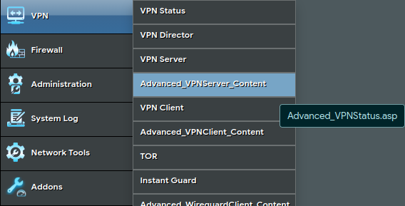
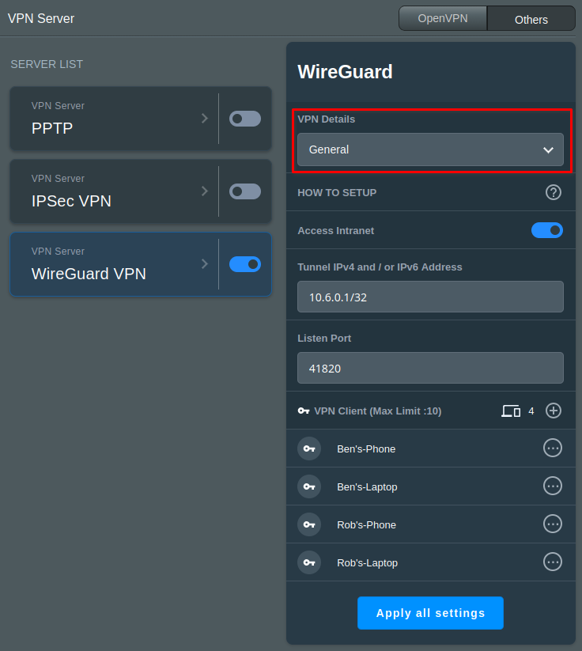
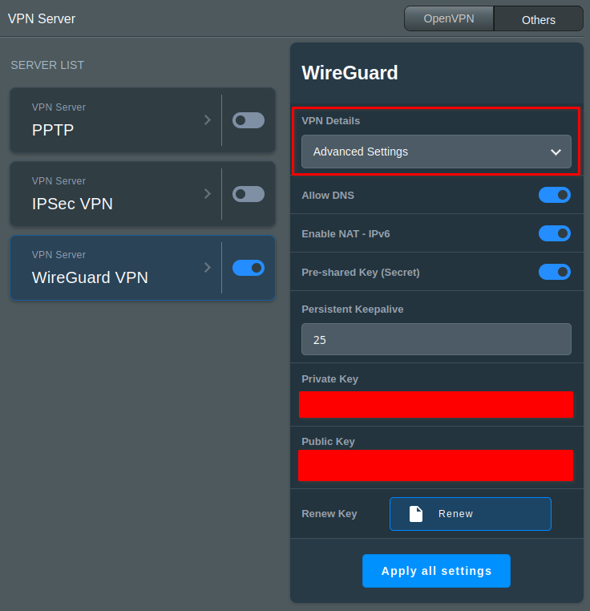

{ width=200 }

# WireGuard

_A Simple, Modern VPN_

[GitHub&ensp;:brands-github:](https://github.com/chicohaager/zimaos-wireguard-sysext){ .md-button .md-button--primary }&emsp;[Documentation&ensp;:symbols-files:](https://www.wireguard.com/){ .md-button .md-button--primary }

---

{ width=400 align=right .on-glb }
{ width=400 align=right .on-glb }

## :symbols-info:&ensp;Overview

An extremely simple yet fast and modern VPN that utilizes state-of-the-art cryptography.

&ensp;&ensp;

**Port(s)**

- `41820`
{ .no-bullets }
- `51820`
{ .no-bullets }

**URL / Access**

-   :symbols-waypoints:&ensp;Server Endpoint(s):
{ .no-bullets }
    - `rac3r4life.myaddr.dev:41820`
    - `rac3r4life.myaddr.dev:51820`
-   :symbols-monitor-cog:&ensp;Web UI Admin:
{ .no-bullets }
    - <https://asusrouter.internal:8443/Advanced_VPNServer_Content.asp>
    - <http://storage-server.internal/modules/wireguard/index.html>

**Credentials**

-   [:services-bitwarden:&ensp;Bitwarden](https://vault.bitwarden.com "Bitwarden Web Vault"){ external-link }
{ .no-bullets }
    - Local Network&ensp;:symbols-move-right:&ensp;"ASUS Router"
    - Local Network&ensp;:symbols-move-right:&ensp;"ZimaOS NAS (admin)"

**Client Profiles**

-   :symbols-router:&ensp;ASUS RT-BE92U:
{ .no-bullets }
    - `Ben's-Phone`
    - `Ben's-Laptop`
    - `Rob's-Phone`
    - `Rob's-Laptop`
-   :symbols-server-nas:&ensp;ZimaOS NAS:
{ .no-bullets }
    - `ben-laptop`
    - `ben-phone`
    - `rob-laptop`
    - `rob-phone`

## :symbols-package-search:&ensp;Deployment Details

| Host Device                                                            | Method                          | Container Name | Image | Status { data-sort-method="none" }                                                                               | Port(s) |
| :--------------------------------------------------------------------- | :------------------------------ | :------------- | :---- | :--------------------------------------------------------------------------------------------------------------- | :------ |
| [:symbols-router:&nbsp;ASUS RT-BE92U](../02_hardware/asus_rt-be92u.md) | :symbols-tux:&nbsp;Native Linux | `-`            | `-`   | { style='vertical-align: middle;' } | `41820` |
| [:symbols-server-nas:&nbsp;ZimaOS NAS](../02_hardware/zimaos_nas.md)   | :symbols-tux:&nbsp;Native Linux | `-`            | `-`   | { style='vertical-align: middle;' }   | `51820` |

---

## :symbols-settings:&ensp;Configuration

1.  Log into the [ASUS Router's Web UI](https://asusrouter.internal:8443){ external-link } and navigate to the **"Advanced VPN Server Content"** page.

    { .on-glb width=500 }

2.  Select **"General"** in the drop-down menu to add / remove / edit clients, change the tunnel IP address, change the listening port, or turn on / off intranet access.

    { .on-glb width=500 }

3.  Select **"Advanced Settings"** in the drop-down menu to configure DNS, IPv6 NAT, persistent keepalive, and change the server's pre-shared key.

    { .on-glb width=500 }
